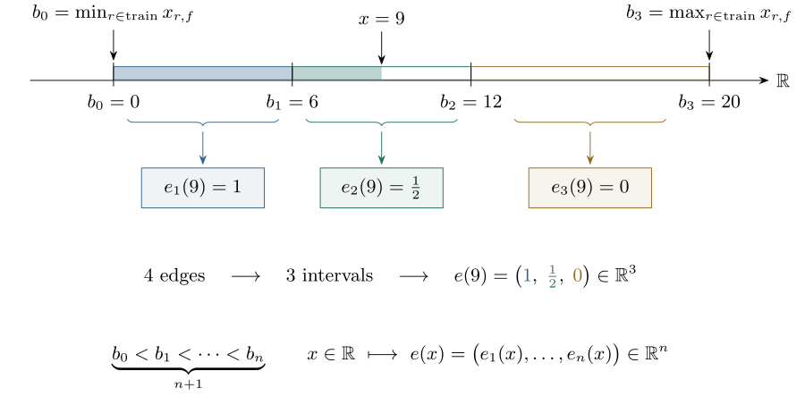
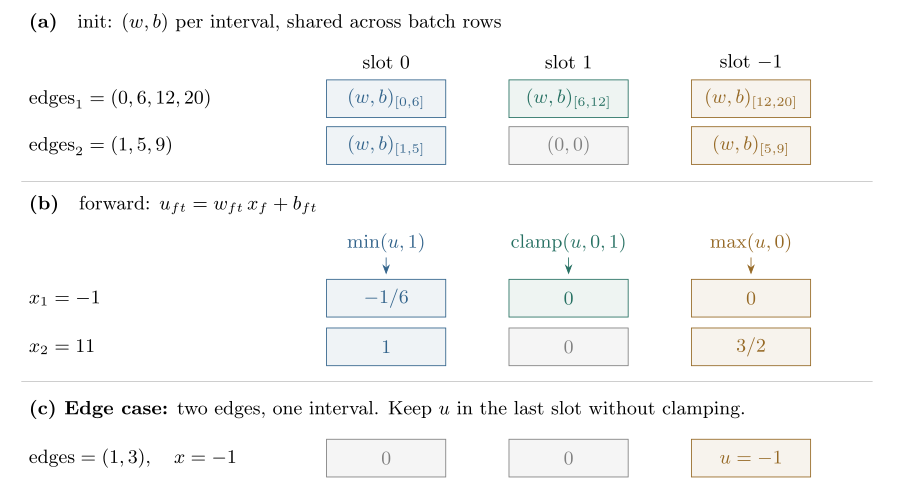
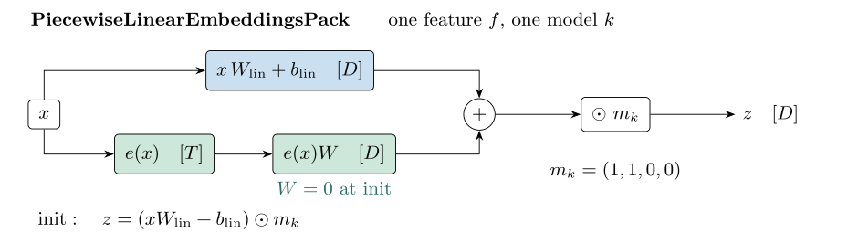
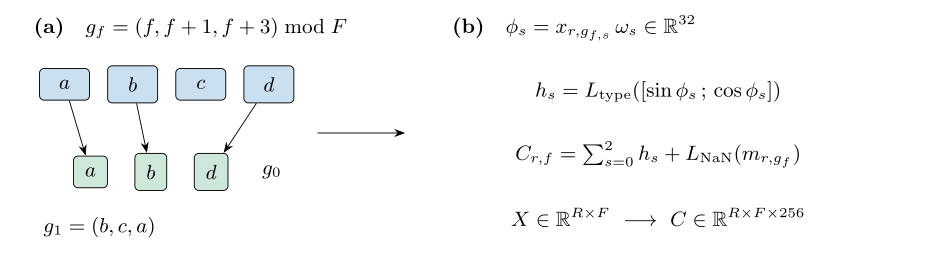
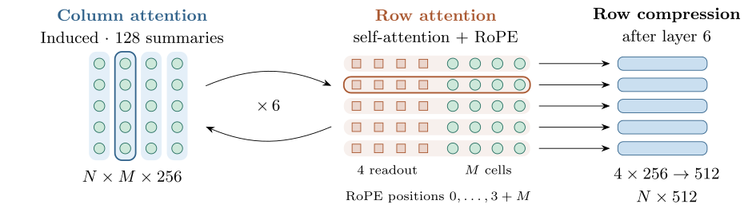
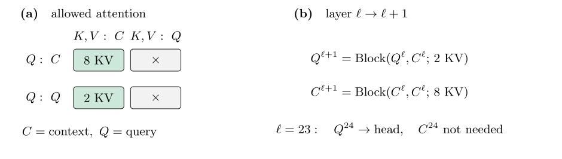

# Tabular DL Homework

В домашнем задании вам нужно будет заняться:

- `[3 балла]` PLE Embeddings для tabpack
- `[4 балла]` архитектура kumo tabular
- `[3 балла]` сравнением моделей на двух датасетах из табличных бенчмарков.

**Бонусом** `[3 балла]` будет "open ended" задача – улучшить эмбединги на этих же двух датасетах *любой ценой*.

Таким образом за дз можно `[0, 13]` баллов. Советую открыть этот человеко написанный текст в соседнем окне рядом с кодом и терминалом и воспринимать как инструкцию.

# Настройка окружения и данные

Откройте терминал прямо в каталоге задания и выполните три команды. Работать мы будем с кодом *в файлах* а не в ноутбуке, помимо инструкции в соседнем окне и кодом полезно будет иметь под рукой и терминал.

Скачайте данные и чекпоинты и установите зависимости. Очень рекомендуем использовать [`uv`](https://docs.astral.sh/uv/).

По началу можно будет запускать код локально на ноутбуке (а если у вас современный мак, то в целом всё дз должно отработать хорошо). Для полных экспериментов используйте машину с GPU.

``` bash
uv sync --frozen
sh data/fetch.sh
sh weights/fetch.sh
```

Числа для маленьких тестов уже есть в `tests/medium_probes.pt`, для них скачивать веса не нужно.

Основная работа будет происходить в двух файлах:

- [tabpack.py](tabpack.py): модуль эмбедингов
- [kumo.py](kumo.py): архитектурные блоки табличной foundation модели

В папке `tests` лежат тесты, ваша реализация должна проходить все, запустить можно командой `make test`.

В папке `experiments`  уже сгенерированы конфиги интересующих нас в этом ДЗ обучений, а в `train_tabpack.py` и `train_kumo.py` написан код обучения и инференса моделей, их вам нужно будет просто запустить (и по желанию почитать).

# Piecewise Linear Embeddings & TabPack · 3 балла

В этой части нужно реализовать кодирование и слой эмбедингов:

`piecewise_linear_encoding` (фиксированная часть кодирования числа в вектор "бинов") и `PiecewiseLinearEmbeddingsPack` (tabpack версия PLE эмбедингов).

Чтобы освежить в памяти то как устроены эмбединги можно посмотреть секции 3 и 3.2 [статьи: On Embeddings for Numerical Features](https://arxiv.org/abs/2203.05556).

## 1. векторизованный `piecewise_linear_encoding`

В этой части вам нужно реализовать следующий [код из `ple_reference.py`](ple_reference.py), но эффективно и векторно.

Представим что у нас всего один признак и $n+1$ квантилей. Тогда для признака будем получать эмбединг размера $n$ из интервалов.

На рисунке пример кусочно линейного эмбединга для одного признака:



**Но признаков много.** А мы хотим считать их векторизованно. Полезное наблюдение для векторной реализации в том что $e_i(x)$ можно переписать как линейное преобразование с правильным весом и сдвигом и `clamp(0,1)` активацией (за исключением границ где мы хотим интерполировать т.к. квантили были посчитаны по обучающей выборке, и мы хотим отличать $x = -1$ от $x = -10$ на тесте).

**Note**: т.к. левая и правая границы обрабатываются отлично от всех остальных интервалов, полезно положить веса соответствующие им в по индексам 0 и -1 соответственно (так для нескольких признаков с разным числом границ не придется запоминать индекс крайней правой границы). Остатки нужно игнорировать (такой вот необычный padding).

Не забудьте про случай когда у нас всего две границы.



1. В `encoding_coefficients` выведите $w,b$ из условий $u(l)=0$, $u(r)=1$. Для `F` признаков верните две матрицы `[F,T]` и маску для признаков с одним интервалом `[F]`. `T` — максимальное число бинов.
2. В `piecewise_linear_encoding` вычислите доли сразу для всего батча: `[B,F] → [B,F,T]`. В pack добавляется ещё одна размерность, для набора моделей: `[K,B,F]` и коэффициенты `[K,F,T]` дают `[K,B,F,T]`.

Если вы всё реализовали правильно должны пройти тесты

```sh
make test_ple_encoding
```

## 2. PiecewiseLinearEmbeddingsPack: конструктор и forward

Для каждого признака сложите два эмбединга одного числа: `x * linear_weight + linear_bias` и `encoding @ encoding_weight`. На старте `encoding_weight` нулевая: сначала эмбединг линейный, а поправка по интервалам может выучиться позже.



**Что написать в `__init__`.** `K = pack_size`, `F = n_features`, `T = max_bins`, `D = max_d_embedding`. `bin_edges[k][f]` — границы признака f у модели k.

1. Для каждой модели k вызовите `encoding_coefficients(bin_edges[k], T)`. Сложите результаты по оси моделей. Сохраните `w`, `b` формы `[K,F,T]` и `single_bin_mask` формы `[K,F]` как `BufferPack`: они не обучаются.
2. Создайте три `ParameterPack`. У `linear_weight` и `linear_bias` форма `[K,F,D]`. Для модели `k` обе величины инициализируйте равномерно в пределах $[-1/\sqrt{d_k},1/\sqrt{d_k}]$, где `d_k = d_embedding[k]`. У `encoding_weight` форма `[K,F,T,D]`; заполните её нулями.
3. Создайте булев `output_mask[K,D]` как `BufferPack`. В строке `k` включены первые `d_k` каналов.

Проверьте конструктор отдельно: `make test_ple_init`.

**Что написать в `forward`.** Аккуратно применить `piecewise_linear_encoding` и линейные слои, не забыть про маску. Если вдруг не получается пройти тест на скорость, обратите внимание на ([issue](https://github.com/yandex-research/rtdl-num-embeddings/issues/19))

```sh
make test_ple_pack
make test_ple_speed   # CPU, 1 поток; минимум 10× относительно цикла на той же машине
```

# Foundation модели · 4 балла

Реализуйте forward pass для [Kumo Tabular](https://arxiv.org/abs/2611.23001), версия Medium.

**Важно**: чтобы не сломать загрузку чекпоинта важно не изменять назваия и размеры параметров. Мы постарались изобразить релевантные схемы слоев, обращайтесь к оригинальной статье и схемам и описаниям оттуда если вдруг запутаетесь.

## 3. Группировка и эмбединги признаков



Функция `groups(F)` должна возвращать индексы групп фичей формы `[F,3]`. При F = 4 ожидаются тройки (a,b,d), (b,c,a), (c,d,b), (d,a,c).

Дальше нужно применить эмбединги и эмбединг пропусков. (хотя в наших датасетов их и нет, тесты проверяют корректность в  этом месте).

``` bash
make test_kumo_cells
```

## 4. Encoder: Induced attention (в колонках) и MHA с RoPE (в рядах)

В `KumoMedium.encoder` таблица из `N` строк и `M` колонок превращается в `N` векторов для ICL. После `cell_embedding` у каждой ячейки свой вектор: `[N,M,256]`. К ячейкам первых `n = len(y)` строк прибавьте эмбединг метки этой строки (`y_emb` для класса, `y_lin` для числового таргета).



1. **Вдоль колонки (`Induced.forward`, col-block).** Переставьте оси: `[N,M,256] → [M,N,256]`. Теперь каждая колонка — отдельный элемент батча. Сначала 128 обучаемых запросов `inducing_points` читают только первые `n` ячеек этой колонки. Затем все `N` ячеек читают полученные 128 векторов. На выходе столько же ячеек, сколько на входе. Верните оси в исходный порядок.
2. **Внутри строки (row-блок).** Перед `M` ячейками каждой строки поставьте четыре readout-токена (квадраты на рисунке, уже есть в конструкторе класса `KumoMedium`). В первых пяти блоках все `4+M` токенов строки читают друг друга. В следующую пару блоков передайте обновлённые ячейки и readout; заново инициализировать readout не нужно. RoPE применяется только здесь: позиции `0…3` занимают readout, `4…3+M` — ячейки. Это позиции *внутри строки*, не номера строк таблицы. (https://blog.eleuther.ai/rotary-embeddings/ -- напоминалка про RoPE).
3. **Сжатие строки.** В шестом row-блоке запросы нужны только для четырёх readout, а ключи и значения — для всех `4+M` токенов. Примените `norm` к результату `[N,4,256]`, объедините последние две оси и вызовите `row_project`: `[N,1024] → [N,512]`. Верните все `N` строк, включая контекст.

```sh
make test_kumo_encoder
```

## 5. ICL



Почти обыкновенный Transformer Encoder. Отличие в том что есть query векторы -- тестовые объекты, которые смотрят только на трейн и не смотрят друг надруга (при этом на трейне смотрят ). Также не забудьте добавить эмбединги таргета к эмбедингам рядов из обучающей выборки, и не забывайте что тестовые query используют только первые две KV головы.

``` bash
make test_kumo_icl
make test_kumo_weights
```

# Эксперименты · 3 балла

Для TabPack значение val считается до refit. Для test выбранные модели обучаются с нуля на train + val столько эпох, сколько выбрала валидация. Препроцессинг, границы PLE и масштаб таргета остаются от train. Время в отчёте включает оба этапа; старый отчёт пересчитайте с `--force`.

Все конфиги экспериментов уже сгенерированы (там почти ничего нет потому что все модели у нас оперируют с "дефолтными гиперпараметрами"). Ваша задача в этой секции обучить модели.

```sh
uv run python -m lib.run experiments/otto/tabpack-ple
uv run python -m lib.run
```

Для Colab сначала авторизуйтесь локально по [инструкции Colab CLI](https://github.com/googlecolab/google-colab-cli). Для запуска по SSH нужны локальный SSH-ключ и сессия, в которой разрешён SSH. На бесплатном managed runtime без положительного баланса compute units используйте команду без `--colab` из каталога задания в ноутбуке.

```sh
uvx --from google-colab-cli colab new -s tabular-hw --gpu T4
uv run python -m lib.run --colab
uvx --from google-colab-cli colab stop -s tabular-hw
```

Скрипт использует Colab CLI и SSH, показывает вывод обучения в терминале и скачивает каждый готовый отчёт в каталог эксперимента.

**Как сдавать дз.** Приложите результаты экспериментов в виде txt файла в архив с кодом из этой папки.

# Бонус · 3 балла

После того как вы запуститили эксперименты, понятно что CosineEmbedding в табпак, хороший бейзлайн, но иногда PLE эмбединги могут работать и получше (otto). Также будет примерно видно насколько табличная foundation модель впереди ансамбля MLP (*намного ли?*)

Мотивация бонусной части – дать вам свободу поиграться с архитектурным ресерчем в мире табличного DL.

Нужно породить единую, простую (без ифов про датасеты) схему embedding'ов числовых признаков, которая будет работать лучше Cosine и PLE на обоих датасетах. Насколько это выполнимая в рамках ДЗ задача – интересный вопрос, поэтому задание и бонусное.

Надеюсь позапускав эксперименты вы поняли что итерироваться можно достаточно быстро (при условии современных GPU), а имплементируя модули эмбедингов и foundation модели просто поупрожнялись с разными идеями.

Добиваться успеха можно любыми способами:

- использовать инициализацию из Kumo
- группировать признаки (например, вдохновившись тем как это делают foundation модели)
- менять оптимизатор
- всё что угодно что придет вам на ум.

Возможно полезно сдеалть сабсемпл датасета отто если итерации на нем слишком длинные.

**В этой (ТОЛЬКО В БОНУСНОЙ) части ДЗ МОЖНО использовать агентов**

Бонус — 3 балла, если на seed 0 одна схема улучшает val-метрику лучшего из двух TabPack на обоих датасетах. Test только укажите в отчёте.
